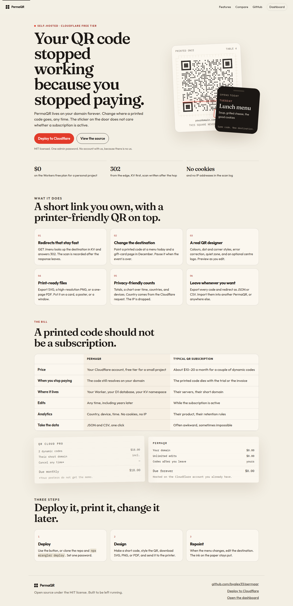
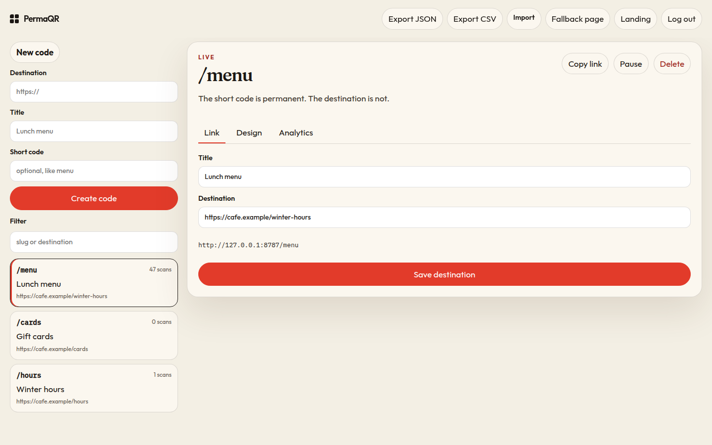
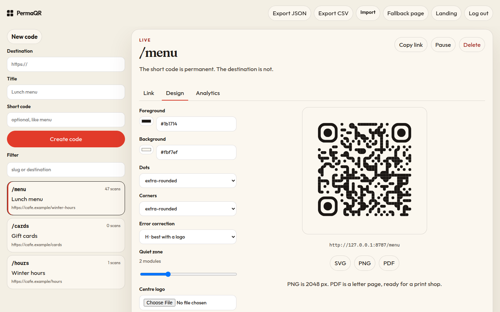
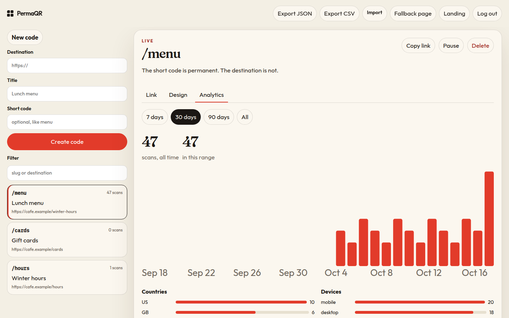

# PermaQR

Your QR code stopped working because you stopped paying.

PermaQR is an open-source dynamic QR code app you host yourself. It runs on [Cloudflare’s free tier](https://developers.cloudflare.com/workers/platform/pricing/), on your domain. A printed code keeps resolving after a trial ends, and you can change the destination whenever you want.

[](https://deploy.workers.cloudflare.com/?url=https://github.com/byalex33/permaqr)

[Source on GitHub](https://github.com/byalex33/permaqr) · MIT licensed

## What it looks like









## Features

- **Short-code redirects.** `GET /menu` reads KV first and answers `302`. A scan (time, country, device, OS, referrer host) is written with `ctx.waitUntil`, so the hop does not wait on the database.
- **One admin.** Create, edit, pause, and delete codes. Custom slugs. The short code stays put; the destination is what you change. An optional hosted mode, off unless you set it, adds separate paid workspaces on one instance. A normal self-host does not use it.
- **QR designer.** Foreground and background, dot and corner styles, error correction, quiet zone, optional centre logo, live preview.
- **Print files.** SVG, a 2048 px PNG, and a letter-size PDF.
- **Analytics.** Total scans, a chart over time, top countries, devices. No cookies. No IP stored.
- **Export and import.** JSON or CSV of every code and redirect, so you are not locked in.
- **Fallback page.** A plain message for paused or unknown codes. You can edit the wording.
- **Optional Cloudflare Access.** Password is the default. If you set a team domain and an Access audience tag, a verified Access JWT is also accepted.

There is no AI in this project.

## Quick start

Requirements: Node.js 22+, a Cloudflare account.

**Deploy with the button** at the top of this file. Cloudflare clones the repo, asks for `ADMIN_PASSWORD`, creates the D1 database and KV namespace, builds the app, and deploys it. After the first deploy, open `/login`.

**Or from your machine:**

```sh
git clone https://github.com/byalex33/permaqr.git
cd permaqr
npm install
npx wrangler login
printf '%s' "$(openssl rand -base64 24)" | npx wrangler secret put ADMIN_PASSWORD
npm run deploy
```

`npm run deploy` builds the UI, applies D1 migrations to the remote database named by the `DB` binding, then runs `wrangler deploy`.

Copy `.dev.vars.example` to `.dev.vars` if you want to run it locally first:

```sh
cp .dev.vars.example .dev.vars
npm run dev
```

Open [http://localhost:8787](http://localhost:8787). The password is whatever you put in `.dev.vars`.

## Self-hosting

### Cloudflare resources

Names match [`wrangler.jsonc`](wrangler.jsonc).

| Resource | Wrangler name | Purpose |
| --- | --- | --- |
| Worker | `permaqr` | Redirects, API, and static UI |
| D1 binding | `DB` | Codes, scans, fallback message |
| D1 database name | `permaqr` | The database created for that binding |
| KV binding | `CODES` | Hot cache for redirect lookups |
| Secret | `ADMIN_PASSWORD` | Dashboard password |
| Static assets | `ASSETS` (`./dist/client`) | Landing page and dashboard |

Placeholder ids in the config (`database_id`, KV `id`) are defaults so the [Deploy to Cloudflare](https://developers.cloudflare.com/workers/platform/deploy-buttons/) button can provision real resources and rewrite them. Wrangler 4.45+ can also create a missing KV namespace, D1 database, or R2 bucket on deploy.

Optional vars, commented in `wrangler.jsonc`:

- `CF_ACCESS_TEAM_DOMAIN` — for example `your-team.cloudflareaccess.com`
- `CF_ACCESS_AUD` — the Access application’s audience tag

Both must be set. PermaQR checks the JWT signature against your team’s Access certs. The `Cf-Access-Authenticated-User-Email` header alone is not trusted.

### Manual setup

1. Install dependencies: `npm install`
2. Log in: `npx wrangler login`
3. Create the database if you are not using automatic provisioning:

   ```sh
   npx wrangler d1 create permaqr
   npx wrangler kv namespace create CODES
   ```

   Paste the printed `database_id` and KV `id` into `wrangler.jsonc`. Keep `binding` as `DB` and `CODES`, and keep `migrations_dir` as `migrations`.

4. Set the password (this creates a Worker version, so do it before or after the first deploy):

   ```sh
   npx wrangler secret put ADMIN_PASSWORD
   ```

5. Apply migrations and deploy:

   ```sh
   npm run deploy
   ```

   To apply migrations on their own:

   ```sh
   npx wrangler d1 migrations apply DB --remote
   ```

   The name `DB` is the binding, not a guess at the database id. That still works if you rename the database during the deploy-button flow.

6. Attach a domain you own (Workers dashboard, or a `routes` entry with `custom_domain`). Print `https://qr.yourdomain.com/menu`, not a host you might abandon.

Local migrations:

```sh
npx wrangler d1 migrations apply DB --local
```

### Free tier, honestly

A personal or small-business set of codes fits Cloudflare’s free plan: Workers requests, D1 rows, and KV reads all have daily limits. A scan is one KV read and one D1 write. Check the current [Workers](https://developers.cloudflare.com/workers/platform/pricing/), [D1](https://developers.cloudflare.com/d1/platform/pricing/), and [KV](https://developers.cloudflare.com/kv/platform/pricing/) limits before you put a code on a stadium poster.

Redirect responses are `Cache-Control: no-store`, so a destination edit is the next scan, not a cached 302.

### Routes

| Path | Who |
| --- | --- |
| `/` | Landing page, or the dashboard if you already have a session |
| `/site` | Landing page, even when you are signed in |
| `/login`, `/app` | Dashboard |
| `/api/*` | JSON API, password or Access |
| `/:slug` | 302, or the fallback page |
| `/health` | `{ "ok": true, "name": "permaqr" }` |

Hosted mode adds routes. They 404 when `HOSTED_MODE` is not `true`, so a self-hosted `/hello` is unchanged:

| Path | Who |
| --- | --- |
| `/u/<handle>/<slug>` | 302 for that customer's code |
| `/account`, `/account/login`, `/welcome` | That customer's dashboard, sign-in, and post-checkout setup |
| `/api/hosted/checkout` | Starts Lemon Squeezy checkout |
| `/api/webhooks/lemonsqueezy` | Lemon Squeezy webhook |
| `/api/operator/accounts` | Operator list, disable, and setup links. Uses the admin session |

### Export format

JSON (version 1) includes the fallback message and every code: slug, title, destination, paused, QR style, timestamps. CSV is `slug,title,destination,paused,created_at`. Scan rows are not in the export. Import with **Import** on the dashboard, or `POST /api/import?format=json|csv&mode=merge|replace`.

## Hosted mode

Hosted mode is a convenience for people who do not want to run their own Worker. It is **off by default**. Leave `HOSTED_MODE` unset and this section does not apply: one `ADMIN_PASSWORD`, codes at `/<slug>`, no checkout, no accounts.

Turn it on only on the instance you sell. Self-hosting stays free and has the same features. The hosted tier is not a feature gate.

### URL scheme

Customer codes live at `/u/<handle>/<slug>`.

`/hello` and every other existing root slug stay on the operator workspace. A customer's `menu` cannot collide with the operator's `menu`, or with another customer's `menu`, because the handle is in the path. The handle is taken from the buyer's email (the part before `@`, made URL-safe, with a numeric suffix if it is taken).

`/u`, `/account`, and `/welcome` are reserved for the operator's own codes while hosted mode is on, so those paths are not swallowed by a root slug. They are not reserved when hosted mode is off.

A hosted account can have 100 codes. Login, checkout, and password setup are rate limited per IP. The operator can disable an account; its codes then stop resolving. Enable turns them back on.

### What the buyer does

1. They use **Pay $29 once** on the landing page. That hits `/api/hosted/checkout`, which stores a short-lived claim cookie and sends them to Lemon Squeezy with `checkout[custom][claim]` set.
2. Lemon Squeezy sends `order_created` to the webhook. A paid order for the configured variant creates a workspace for `user_email`. The same order twice does not create a second workspace. A second paid order for the same email reuses the workspace and does not reset the password.
3. The confirmation button sends them to `/welcome?order_identifier=[order_identifier]`. That page waits for the webhook, then they set a password (10 characters or more). The order identifier works as the setup credential for 7 days, until a password is set. Passwords are stored as PBKDF2-SHA256 hashes. The session cookie is HMAC-signed, `HttpOnly`, and `SameSite=Lax`, and it is not an operator session.
4. Their dashboard is `/account`. Codes, analytics, the designer, and export are the same screens, scoped to that account. The printed URL looks like `https://<your-host>/u/ada/menu`.

There is no email sender in this app. Magic links would need one, and sending from `workers.dev` needs a verified domain, which this deploy does not have. If the buyer never opens the confirmation button, sign in as the operator and use **Hosted accounts → New setup link**. That clears their password and shows a one-time URL. You have to give them that URL yourself.

`order_refunded` disables the workspace. Test-mode orders provision real workspaces on this instance; disable them, or turn test mode off in Lemon Squeezy, before you call the store live.

### Lemon Squeezy

Create a store and a **one-time** product at **$29** (not a subscription). Lemon Squeezy is the merchant of record and handles VAT.

In the product's confirmation modal, set the button link to:

```text
https://<your-worker-host>/welcome?order_identifier=[order_identifier]
```

Keep the square brackets. Lemon Squeezy replaces `[order_identifier]` with the order UUID. Do not use `[order_id]`; that value is a short number.

Create a webhook:

| Setting | Value |
| --- | --- |
| URL | `https://<your-worker-host>/api/webhooks/lemonsqueezy` |
| Signing secret | A random string. The same value goes in `LEMONSQUEEZY_WEBHOOK_SECRET` |
| Events | `order_created` (required). `order_refunded` (disables the workspace) |

The buy link looks like `https://YOURSTORE.lemonsqueezy.com/checkout/buy/YOUR-VARIANT-UUID`. Put that in `LEMONSQUEEZY_CHECKOUT_URL`. The variant id is the numeric id on the variant, not the UUID in the URL. Set `LEMONSQUEEZY_VARIANT_ID` so an order for a different product on the same webhook does not create an account. If you leave the variant id unset, every paid `order_created` on that webhook provisions one.

The landing price is written as `$29`. If you charge a different amount in Lemon Squeezy, change the landing copy to match. PermaQR does not read the price from Lemon Squeezy.

### Worker configuration

`HOSTED_MODE` must be the string `true`. Anything else, including unset, is single-admin mode.

For a deployed Worker:

```sh
npx wrangler secret put LEMONSQUEEZY_CHECKOUT_URL
npx wrangler secret put LEMONSQUEEZY_WEBHOOK_SECRET
```

Put the non-secret flags in `wrangler.jsonc` under `vars` (there is a commented example), or with `wrangler`:

```sh
npx wrangler secret put HOSTED_MODE
# value: true
npx wrangler secret put LEMONSQUEEZY_VARIANT_ID
# value: the numeric variant id, optional
```

`HOSTED_MODE` and `LEMONSQUEEZY_VARIANT_ID` can be plain vars instead of secrets. The checkout URL is public, but a secret is a fine place for it. `ADMIN_PASSWORD` is still required; it signs operator sessions and hosted sessions, and it is the operator's own login.

Local `.dev.vars` accepts the same names. See `.dev.vars.example`.

Apply the new migration before serving hosted traffic. `npm run deploy` does this. On its own:

```sh
npx wrangler d1 migrations apply DB --remote
```

Locally:

```sh
npx wrangler d1 migrations apply DB --local
```

That applies `migrations/0002_hosted.sql` (accounts, orders, per-account codes, per-account fallback text). It does not change the existing `codes` table. Redirects still answer 302 from KV. The hosted cache key is `u:<handle>:<slug>`, so it cannot overwrite an operator entry. The scan is still written with `waitUntil` after the response.

Operator login stays at `/login`. The hosted-accounts list is on that dashboard when hosted mode is on.

## Development

```sh
npm test          # vitest, Workers runtime
npm run typecheck
npm run dry-run   # vite build + wrangler deploy --dry-run
```

See [CONTRIBUTING.md](CONTRIBUTING.md).

## Roadmap

- Bulk sheet of QR codes as one PDF
- Rollups so very high scan volume does not grow the scans table forever
- More than one operator on a self-hosted install, if password-plus-Access is not enough
- A webhook when a code crosses a scan count
- Per-code schedules (publish the new destination at a time)

Not planned: a self-hosted install that phones home. Hosted accounts exist only when `HOSTED_MODE=true` on an instance you run yourself.

## License

[MIT](LICENSE) © 2026 Alex
